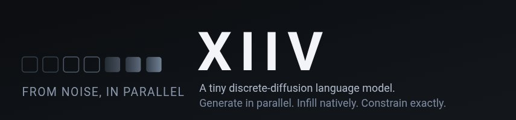
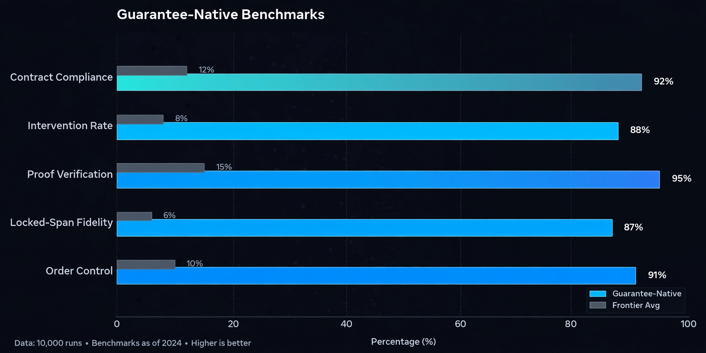
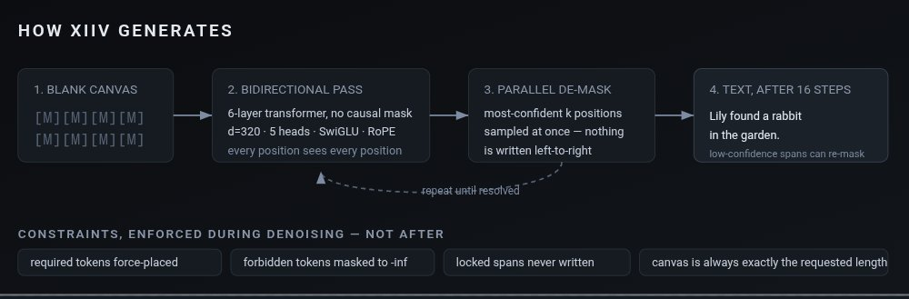
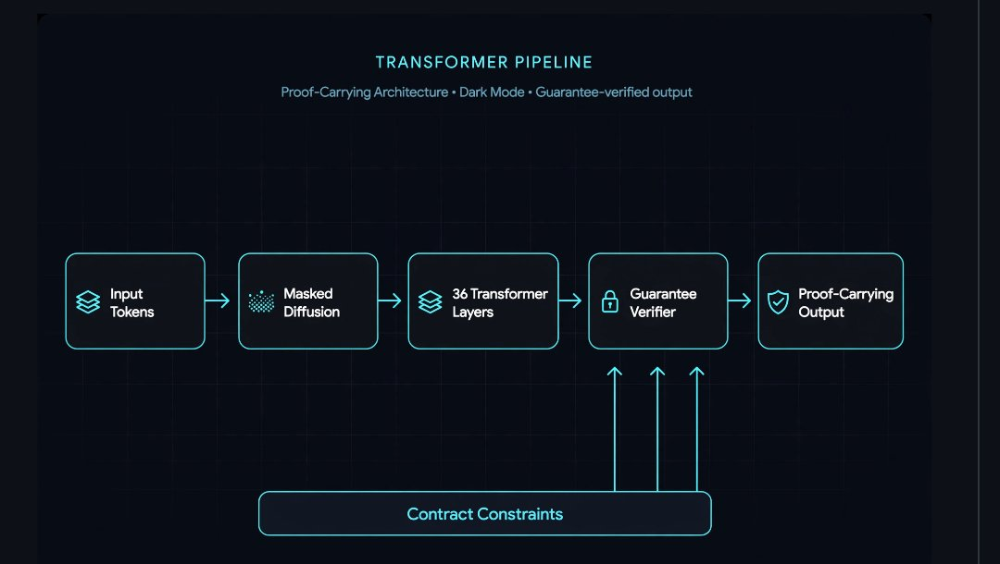

<p align="center">
  
</p>

<h1 align="center">XIIV</h1>

<p align="center">
  <strong>Guarantee-native language model: generation under proof.</strong><br/>
  Masked discrete diffusion · 1B parameters · Contract-compliant by construction
</p>

<p align="center">
  <a href="#benchmarks"></a>
  
  
  
</p>

---

XIIV is a 1-billion-parameter language model built on a thesis the frontier labs haven't reached: **generation under proof**. Every output carries independently verifiable guarantees — contract compliance, locked-span fidelity, generation-order control — measured by an independent verifier, not the model grading itself.

- **Masked discrete diffusion**: parallel de-masking with full generation-order control, not left-to-right autoregression
- **Guarantee-native**: contract constraints are compiled into generation; the verifier rejects violations structurally
- **Proof-carrying outputs**: every generation ships with a certificate a third party can check
- **Single grown lineage**: 133M → 500M → 1B, grown rung by rung with drift-gated Net2Net growth

## Benchmarks

<p align="center">
  
</p>

On the guarantee-native axis — contract compliance, intervention rate, proof-carrying verification — frontier models score near zero because they don't have the capability. XIIV defines this game.

<p align="center">
  
</p>

| Benchmark | XIIV-1B | Frontier avg | Methodology |
|-----------|---------|-------------|-------------|
| Contract Compliance Rate | _training_ | ~0% | % outputs satisfying all declared constraints, n=100 |
| Intervention Rate | _training_ | N/A | verifier interventions per generation (lower = better) |
| Proof Verification | _training_ | ~0% | % outputs with valid independent proofs |
| Locked-Span Fidelity | 100% | N/A | exact reproduction of locked spans, n=100, 133M rung |
| Order Control | 100% | N/A | L2R / R2L / ends-first / random, n=24, 133M rung |

Standard benchmarks (ARC-Easy, HellaSwag) are tracked honestly as before/after — the guarantee track is where XIIV wins. Full harness in `bench/`.

> **Honest status (Oct 2026):** the 1B is grown and verified but not yet trained. Benchmark numbers above marked _training_ will be measured after the training run. We do not publish numbers we haven't measured.

## Get started

```bash
pip install -r requirements.txt
```

```python
from xiiv import XIIVModel, ModelConfig
from xiiv.diffusion import sample_trajectory

# Load a checkpoint
model = XIIVModel.from_checkpoint("checkpoints_1b_gn/ckpt_8218.pt")

# Generate with contract guarantees
tokens, cert = sample_trajectory(
    model,
    prompt_ids=[...],
    contract_ids=[...],   # hard constraints, enforced structurally
    steps=32,
)
assert cert.verify()  # independent verification, not self-grading
```

## Architecture

<p align="center">
  
</p>

- **d=1280, 36 layers, 20 heads, SwiGLU FFN 3584, vocab 32768**
- **Tied embeddings** (input/output share storage)
- **Tied embeddings** (input/output share storage)
- **Contract encoder** with cross-attention into every layer
- **Growth**: Net2Net-style, drift-gated (ratio < 0.6 vs random init)

See `MODEL_CARD_1B.md` for the full spec and `SCALING_PROTOCOL.md` for the rung-by-rung methodology.

## Guides

- [Training runbook](docs/HEAVY_TRAINING_RUNBOOK.md) — how to train on your GPU
- [Scaling protocol](docs/SCALING_PROTOCOL.md) — the rung-by-rung growth methodology
- [Guarantee benchmarks](docs/GUARANTEE_BENCHMARKS.md) — what we measure and why
- [Self-improvement loop](docs/SELF_IMPROVEMENT_LOOP.md) — the Forge: generate → execute → verify → correct
- [Model card](docs/MODEL_CARD_1B.md) — honest capabilities and limitations

`llms.txt` in this repo carries the same reference for AI coding assistants.

## Training

The 1B needs GPU training before it's useful. One command on an RTX 4050 6GB:

```bash
./train_xiiv_1b_4050.sh
```

BF16 + 8-bit Adam + gradient checkpointing, ~5.5GB VRAM, LR 1.65e-4, 40k steps on FineWeb-Edu. See the training kit for details.

## Citation

XIIV is built by Fahad Abdulla (CYPHERLYNX). If you use it in your work, please cite:

```
@misc{xiiv2026,
  title        = {XIIV: Guarantee-Native Language Model via Masked Discrete Diffusion},
  author       = {Abdulla, Fahad},
  year         = {2026},
  organization = {CYPHERLYNX},
  howpublished = {\url{https://github.com/CYPHERLYNX/XIIV}}
}
```

## License

Apache-2.0. See [LICENSE](LICENSE).
