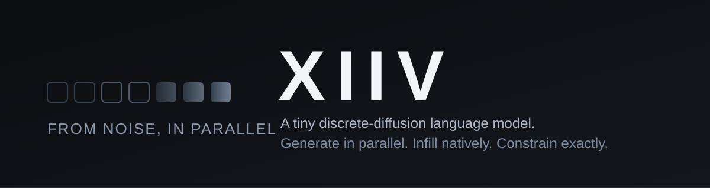
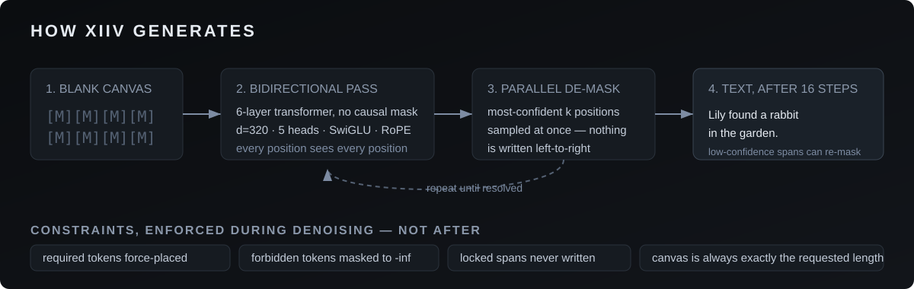
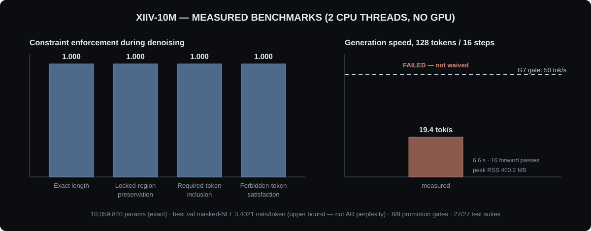

<p align="center">
  
</p>

A from-scratch language model that doesn't predict left-to-right. Every generation begins as a blank stretch of `[MASK]` tokens, and the model iteratively resolves the most confident tokens into text, in parallel, over a handful of steps. Text infilling, editing, and constrained regeneration fall out of the architecture natively — no prompting tricks, no scaffolding. 10M parameters, trained on CPU, runs anywhere.

- **Parallel de-masking**: the whole canvas is denoised at once — the *k* most confident masked positions resolve every step, in no particular order. No causal mask, no KV cache.
- **Constraint-native generation**: required tokens are force-placed, forbidden tokens are masked to −inf in the logits, locked spans are never written to, and the canvas is always exactly the requested length. Compliance measures 1.000 on all four benchmarks.
- **Infill as a primitive**: `<mask>` spans inside your text resolve in place while surrounding context is preserved byte-exact — the mechanism, not a prompt template.
- **Diffusion-native revision**: low-confidence spans can be re-masked and re-denoised in place (`self_refine`), and a scratchpad can be denoised first with the answer conditioned on it (`generate_with_scratchpad`).

<p align="center">
  
</p>

XIIV-10M is a 6-layer bidirectional transformer (d=320, 5 heads, SwiGLU FFN-864, RoPE, RMSNorm, tied embeddings), byte-level BPE vocabulary of 8,192, fixed 128-token canvas — 10,059,840 parameters exactly. Training follows the LLaDA-style masked-diffusion objective: sample a mask ratio *t* ∼ Uniform(0.15, 1.0), replace tokens with `[MASK]` independently with probability *t*, reconstruct masked positions only. The shipped weights (`weights/xiiv.safetensors`, 38.4 MiB fp32) trained 5,000 steps / 30.7M TinyStories tokens on 2 CPU threads (bf16).

## Benchmarks

<p align="center">
  
</p>

Constraint scores are measured compliance on the benchmark suite in `benchmarks/`; throughput is wall-clock on 2 CPU threads. The masked-LM NLL (best validation 3.4021 nats/token) is an **upper bound** from the training objective — it is *not* comparable to autoregressive perplexity, and we don't present it as such. Promotion gates: **8/9 pass** — G7 (throughput) is recorded as **FAILED** at 19.4 tok/s against a 50 tok/s bar, not waived. If you need raw speed at this size, an autoregressive model is the better tool; diffusion's advantage is parallelism and infilling.

The **52.5M model** (d=576, L=12, h=9 — 52,508,736 params, same objective, trained 5,000 steps / 20.48M tokens on 2 CPU threads) completed 2026-10-02. Best held-out masked-NLL bound **3.3414 nats/token** (step 4,500; step-5,000 eval 3.3473; independent post-export eval on 64 batches: 3.34) — 0.06 nats better than the 10M's 3.4021, a modest gain on a domain-tiny budget. Generation on this box: **20.0 tok/s** at 16 denoise steps (37.9 tok/s at 8 steps), 814 MB peak RSS. G7 (cpu_tok_s≥50) fails at this size too (20.0 < 50). Test suite: **31/31 pass** (incl. the 19/19 structural constraint tests).

The 52.5M weights (105 MB fp16 — above GitHub's 100 MB plain-file limit) ship as a **release asset**, not in the git tree. Download `xiiv-52m-fp16.safetensors` from the [xiiv-52m-v0.1 release](https://github.com/CYPHERLYNX/XIIV/releases/tag/xiiv-52m-v0.1) and place it at `weights_52m/xiiv-52m-fp16.safetensors` (next to `config.json` + `tokenizer.json`, which are in the repo). Then:

```python
from xiiv import XIIV
m = XIIV("weights_52m/xiiv-52m-fp16.safetensors")
print(m.infill("The <mask> sat on the <mask>.", steps=8, seed=3))
```

## Get started

```bash
git clone https://github.com/CYPHERLYNX/XIIV.git && cd XIIV
python -m venv .venv && .venv/bin/pip install -r requirements.txt
# Windows: run setup.bat instead (or train_xiiv_gpu.ps1 for RTX GPU training)
```

```python
from xiiv import XIIV

m = XIIV("weights/xiiv.safetensors")

# infill masked spans — locked context is preserved exactly
print(m.infill("The <mask> sat on the <mask>.", seed=3))
# 'The  map sat on the  Liz.'

# generate 128 tokens from pure noise, 16 denoise steps
print(m.generate(length=128, steps=16, seed=7))
```

The CLI covers the same ground, plus reasoning modes and the local demo:

```bash
.venv/bin/python -m xiiv.sample generate --length 128 --steps 16 --seed 7
.venv/bin/python -m xiiv.sample infill --text "The <mask> sat on the <mask>."
.venv/bin/python -m xiiv.sample generate --scratchpad 32 --length 128  # reason first, then answer
.venv/bin/python -m xiiv.sample generate --refine-rounds 2             # draft + self-correction
.venv/bin/python -m xiiv.serve   # watch de-masking step by step → http://localhost:8765/
```

Weights, tokenizer and config ship in the repo — inference makes **zero network calls**, ever. (This repo is private, so cloning asks for your GitHub credentials.)

## Guides

- [TRAINING.md](TRAINING.md): the full training recipe — data snapshot with hashes, hyperparams, run ledger, resume behavior.
- [MODEL_CARD.md](MODEL_CARD.md): model details, intended use, honest evaluation, what the numbers do and don't mean.
- [DATASET_CARD.md](DATASET_CARD.md): the TinyStories data card and preparation steps.
- [llms.txt](llms.txt): the same reference condensed for AI coding assistants.

## Customisation

XIIV was designed to be retrained. Same objective, your data:

| step | command |
|---|---|
| 1. data | `.venv/bin/python scripts/prepare_data.py --out-dir data --train-chars 150000000 --valid-chars 5000000` |
| 2. train | `.venv/bin/python -m xiiv.train --data data --ckpt-dir checkpoints --total-steps 5000 --batch-size 48 --bf16` |
| 3. evaluate | `.venv/bin/python -m xiiv.evaluate --weights weights/xiiv.safetensors` |
| 4. export | `.venv/bin/python scripts/export_weights.py --ckpt checkpoints/best.pt` |

Training is resumable (Ctrl-C safe; the latest `ckpt_*.pt` is picked up automatically, RNG state included). Configs are frozen with hashes (`run_config.json`) so any run is exactly reproducible. On an NVIDIA GPU (e.g. RTX 4050), run `.\train_xiiv_gpu.ps1` — it builds a CUDA venv and launches the GPU recipe.

## Deploy

The demo server is the deployment reference: `xiiv.serve` binds to `127.0.0.1` only, caps request bodies at 64KB, and serves the trajectory-visualization page from `demo/`. For anything beyond local demos, serve the `XIIV` class behind your own API — the model is plain PyTorch, CPU-only by default.

## Citation

XIIV is built by CYPHERLYNX. If you use it in your work, please cite:

```bibtex
@misc{xiiv2026,
  title        = {XIIV: A Tiny Discrete-Diffusion Language Model with
                  Constraint-Native Generation},
  author       = {CYPHERLYNX},
  year         = {2026},
  howpublished = {\url{https://github.com/CYPHERLYNX/XIIV}}
}
```

## Status and limitations

**Experimental research model (v0.1).** It trains and runs end to end, its constraint machinery measures 1.000, and its numbers are reported honestly — including the gates it failed. The **52.5M-parameter XIIV** (d=576, 12 layers, 9 heads — 52,508,736 params, same objective and constraints) completed training 2026-10-02 (~20:29 IST, 5,000 steps, 20.48M tokens); its weights ship as a release asset (see above). The 10M stays as the CPU-friendly reference.

- Trained on TinyStories (simple children's-story English). It writes simple stories; it does not do math, code, or factual Q&A reliably. Sample outputs above are typical, not cherry-picked.
- Diffusion needs several full-sequence forward passes per generation — slower per token than AR at the same size (see the failed G7); the win is parallelism + infilling, not throughput.
- 30.7M training tokens is tiny by LM standards. Expect repetition and limited vocabulary.
- `xiiv/vision.py` is an untrained multimodal scaffold — architecture only, not a capability.
- Like any LM, it can reproduce phrases from its training data. Don't deploy it where memorization matters.

## Security

- Weights ship as **safetensors** (no pickle). Inference loads only local files.
- The API, CLI and demo server make **zero network requests**.
- `xiiv.serve` binds to `127.0.0.1` only and caps request bodies at 64KB.
- Training checkpoints (`*.pt`) use pickle — only load checkpoints you trained yourself.

## Project layout

```
xiiv/               # model, diffusion objective/sampler, Python API, tokenizer, CLI, eval, demo server
scripts/            # prepare_data.py, export_weights.py, check_gates.py, ...
tests/             # unit tests (no data needed; CI runs them on every push)
benchmarks/        # constraint + throughput benchmarks
weights/           # shipped safetensors + tokenizer.json + config.json
assets/            # banner, architecture and benchmark diagrams
demo/              # local trajectory-visualization page
setup.bat          # one-click Windows setup
train_xiiv_gpu.ps1 # one-click RTX training launcher (Windows)
```

MIT licensed.
